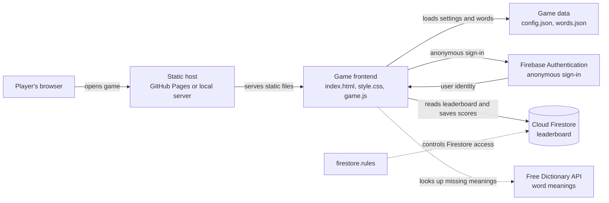

# Word Fix — Firebase Leaderboard

Saves the shared leaderboard from **Cloud Firestore** instead of GitHub Issues or a JSON file.

## What is included

- Static frontend files that can be hosted on GitHub Pages.
- Firestore leaderboard documents, one nickname per difficulty.
- Firebase anonymous sign-in so a browser can update only its own nickname records.
- Firestore security rules in `firestore.rules`.

## Architecture



The browser runs the game and talks directly to Firebase; the static host does not run a backend.

## 1. Create and configure Firebase

1. Create a Firebase project in the [Firebase Console](https://console.firebase.google.com/).
2. In **Project settings → General**, register a Web app and copy its Firebase web configuration into `firebase-config.js`.
   - These web config values identify the Firebase project; they are not server secrets. Keep Firestore locked down with the rules below.
3. In **Authentication → Sign-in method**, enable **Anonymous** sign-in.
4. In **Authentication → Settings → Authorized domains**, add `localhost` for local tests and your GitHub Pages domain (for example, `your-name.github.io`) for the deployed game.
5. Create a **Cloud Firestore** database.
6. Open **Firestore Database → Rules**, replace the starter rules with the contents of `firestore.rules`, and publish them.

The rules allow public leaderboard reads, but require an anonymous Firebase user to write. A user can create a nickname record once and can later update only the same record from the same anonymous browser identity.

The rules' allowed score range (`-20` to `30`) matches the current settings of 10 rounds, +3 points for a right answer, and −2 for a wrong answer. If those scoring settings change in `config.json`, update the limits in `firestore.rules` too.

## 2. Run locally

Firebase Auth and Firestore require a web origin; do not open `index.html` directly as a `file://` URL. From this folder, run:

```bash
python3 -m http.server 8000
```

Then visit `http://localhost:8000`. If Firebase is not configured, the game remains playable, but the page reports that the shared leaderboard is unavailable and scores will not be saved.

## 3. Host the new project on GitHub Pages

1. Create a **new GitHub repository** for this Firebase version. Keep it separate from the original project.
2. Add and push the contents of this folder to the repository.
3. In the repository, open **Settings → Pages** and publish from the `main` branch and `/ (root)`.
4. Ensure the `*.github.io` domain is listed under Firebase Authentication's authorized domains.
5. Open the published Pages URL and test that the leaderboard loads and a completed game saves a score.

GitHub Pages serves the frontend; Firebase Auth and Firestore handle the online leaderboard. The game does not need a GitHub Actions score workflow.

## Security and cost notes

- The web app config is public by design; the Firestore rules are the access control.
- The leaderboard is public. Nicknames and scores are visible to visitors.
- Anonymous sign-in and these rules prevent unauthenticated writes and edits to another browser identity's record. **They do not prove that a score was earned fairly**: a determined user can manipulate their own browser and submit a fabricated score within the permitted range. Do not use this client-only version for prizes, grades, or other high-trust scoring without a trusted backend that validates games.


## Word content

Edit `words.json` to add words, hints, and meanings. The game uses a saved meaning when present and otherwise requests a definition from the Free Dictionary API after the answer. Pronunciation uses the browser's built-in speech synthesis.


## No need here several files like server.py in this firebase project
This project only needs a static file server:
That command serves the existing HTML, CSS, JavaScript, JSON, and Firebase configuration files directly in the browser. It does not replace Firebase or add a Django/Python backend.

The data architecture is also different:

- Firebase handles authentication, database/storage, security rules, hosting, or APIs.
- Browser JavaScript communicates with Firebase through the Firebase SDK.
- A local HTTP server only makes those frontend files reachable in the browser.

A server.py or custom Django server becomes necessary when you need server-side logic, a database accessed privately, login secrets, scheduled jobs, or a custom API.

The previous project likely had server-side responsibilities that this project does not. In this project, simpler is preferable: extra backend files would add deployment work, duplicate Firebase functionality, and expose unnecessary infrastructure.

One important detail: python3 -m http.server is not a production server. It is mainly for local testing. For production, Firebase Hosting or a proper static host can serve the frontend.
